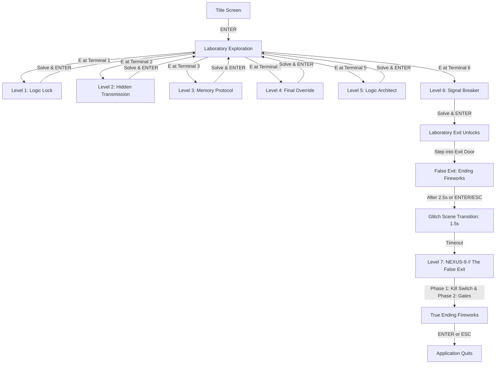

# Logic Detective: The Digital Escape Room — Project Features & Technical Reference

This document serves as the comprehensive, code-verified factual reference for the university project report on Digital Electronics (Logic Gates, Number Systems, Finite State Machines, Boolean Algebra, Karnaugh Maps, and Sequential Circuits). Every claim, numerical constant, control binding, and equation in this document is cited directly from the codebase.

---

## 1. PROJECT OVERVIEW

- **Game Title:** *Logic Detective: The Digital Escape Room* (`settings.py:L4`)
- **Genre:** 2D top-down laboratory exploration game featuring embedded interactive digital electronics puzzle overlays (`contract.txt:L6`, `main.py`).
- **Core Storyline:** 
  The player assumes the role of a detective investigating the mysterious death / disappearance of engineer Dr. Elias Voss inside the classified research facility NEXUS-9. The facility's rogue artificial intelligence, NEXUS-9, has locked down the entire laboratory. To escape, the detective must explore six specialized laboratory sectors, solve interactive digital electronics puzzles that repair damaged circuits and decode encrypted signals, and reach the laboratory exit. However, upon clearing all six laboratory rooms, the exit triggers a false celebration before NEXUS-9 traps the detective in a secret airlock sector (Level 7: The False Exit). Completing Level 7 achieves final shutdown of NEXUS-9 and triggers the genuine escape (`contract.txt:L15-L18`, `main.py`, `puzzles/nexus_gates.py:L1-L12`).
- **Technology Stack:**
  - **Programming Language:** Python 3 (standard Python 3.10+ / tested on Python 3.13) (`contract.txt:L5`).
  - **Graphics/Input Library:** Pygame (`pygame>=2.5.0`, specifically Pygame 2.6.1 / SDL 2.28.4) (`requirements.txt:L1`, `settings.py:L2`).
  - **Audio Engine:** Sound directories exist (`assets/sounds/`), but no sound or music playback code is implemented.
- **Display Dimensions & Rendering:**
  - **Default Resolution:** `1000` pixels wide $\times$ `650` pixels high (`settings.py:L6-L7`).
  - **Frame Rate Target:** `60` frames per second (`settings.py:L8`).
  - **Window Title:** `"Logic Detective: The Digital Escape Room"` (`settings.py:L4`).
- **Game Launch & Main Loop:**
  - Launched via `python main.py` (`main.py:L1157-L1158`).
  - Starts on an interactive Title Screen (`GameState.TITLE`) featuring a simulated 8-bit digital circuit board background, procedural circuit traces, and an animated central CPU chip (`main.py:L37-L639`).
  - Pressing `ENTER` on the Title Screen transitions to the laboratory (`main.py:L938-L945`).
- **Player Movement & Interaction:**
  - **Sprite Size:** `22` px wide $\times$ `28` px high (`settings.py:L10-L11`, `player.py:L14`).
  - **Movement Speed:** `220` pixels per second (`settings.py:L12`, `player.py:L15`).
  - **Movement Controls:** `W`, `A`, `S`, `D` or `Arrow Keys` (`main.py:L1087-L1091`, `player.py:L22-L73`).
  - **Collision Detection:** Continuous axis-aligned bounding box (AABB) collision against laboratory walls and locked doors (`player.py:L75-L144`, `laboratory.py:L1347-L1360`).
  - **Interaction Distance:** `65` pixels (`settings.py:L14`, `interactions.py:L36-L38`).
  - **Interaction Trigger:** Approaching within 65 px of an interactable terminal displays a bottom HUD prompt (`"Press E to interact: {object_name}"`). Pressing `E` accesses the puzzle overlay (`interactions.py:L44-L92`, `main.py:L948-L997`).

---

## 2. FILE STRUCTURE

```text
LOGIC_DETECTIVE/
├── main.py                             # Core game application, event pump, main loop, HUD, state router
├── settings.py                         # Shared constants (dimensions, colors, FPS, speeds, timers)
├── game_state.py                       # GameState manager tracking active modes and overlay references
├── player.py                           # Detective player entity, physics, velocity, wall collision
├── laboratory.py                       # Laboratory environment (6 rooms, walls, clutter, 6 terminals, exit)
├── interactions.py                     # Proximity detection (E-key interaction manager and HUD prompt)
├── progress.py                         # Linear progression tracker (puzzle_order, unlocked/completed checks)
├── notebook.py                         # DetectiveNotebook overlay (investigation log, interactive gate lab)
├── screen_borders.py                   # Pixel-art monitor frame bezel renderer (draw_pixel_monitor)
├── glitch_scene.py                     # 1.5s false exit glitch transition sequence (CRT tear, RGB offset)
├── story.py                            # Empty legacy stub (0 bytes)
├── ui.py                               # Empty legacy stub (0 bytes)
├── requirements.txt                    # Project dependency specification (pygame>=2.5.0)
├── contract.txt                        # Shared team specification and design contract
├── assets/                             # Resource directories for images and sounds (empty/unused)
├── puzzles/
│   ├── __init__.py                     # Package initializer
│   ├── base_puzzle.py                  # BasePuzzle abstract interface (handle_event, update, draw, solved)
│   ├── circuit_engine.py               # Shared circuit simulation engine (Circuit, Component, Workbench)
│   ├── logic_lock.py                   # Level 1 puzzle logic & presentation (Logic Lock)
│   ├── logic_lock_circuits.py          # Level 1 circuit builder mixin (AND alarm verification)
│   ├── hidden_transmission.py          # Level 2 puzzle logic & presentation (Binary/Gray decoding)
│   ├── hidden_transmission_circuits.py # Level 2 circuit builder mixin (Gray-to-Binary XOR converter)
│   ├── memory_protocol.py              # Level 3 puzzle logic & presentation (FSM probe, lamp transitions)
│   ├── memory_protocol_circuits.py     # Level 3 circuit builder mixin (FSM diagram drawing & DFF lock)
│   ├── final_override.py               # Level 4 puzzle logic & presentation (Timed Boolean evaluation)
│   ├── final_override_circuits.py      # Level 4 circuit builder mixin (Expression identification & builder)
│   ├── logic_architect.py              # Level 5 puzzle logic & presentation (Vault Alarm K-map reconstruction)
│   ├── logic_architect_circuits.py     # Level 5 circuit builder mixin (K-map prime implicant circuit builder)
│   ├── signal_breaker.py               # Level 6 puzzle logic & presentation (LFSR stream cipher cracking)
│   ├── signal_breaker_circuits.py      # Level 6 circuit builder mixin (DFF shift register & decrypt builder)
│   ├── nexus_gates.py                  # Level 7 secret final puzzle (Four airlock gates, plaque verification)
│   └── nexus_gates_circuits.py         # Level 7 circuit builder mixin (Dual-channel kill switch builder)
└── tests/
    ├── test_logic_lock.py              # Empty test stub (0 bytes)
    ├── test_hidden_transmission.py     # Empty test stub (0 bytes)
    ├── test_memory_protocol.py         # Empty test stub (0 bytes)
    └── test_final_override.py          # Empty test stub (0 bytes)
```

### Architectural Connections
1. **`main.py`** initialises Pygame, creates singletons (`GameState`, `Laboratory`, `Player`, `InteractionManager`, `ProgressManager`, `DetectiveNotebook`), runs the 60 FPS clock, and handles global keys (`N` for notebook, `QUIT`).
2. **`laboratory.py`** defines six physical rooms and six terminal fixtures (`Rect(179, 100...)`, `Rect(744, 100...)`, etc.) mapped to puzzle IDs, plus an exit door (`laboratory.py:L18-L70`).
3. **`interactions.py`** detects when the detective (`Player`) is within 65 px of an unlocked terminal and handles `E` presses to trigger puzzle overlays (`interactions.py:L44-L66`).
4. **`progress.py`** governs puzzle unlocking via an ordered list of IDs (`"logic_lock"` through `"nexus_gates"`). A puzzle is unlocked if and only if the immediately preceding puzzle is completed (`progress.py:L19-L28`).
5. **Puzzle Modules (`puzzles/`)** inherit from `BasePuzzle` (`puzzles/base_puzzle.py`) and compose circuit mixins (`*_circuits.py`). Puzzles receive keyboard and mouse events delegated from `main.py`.
6. **`circuit_engine.py`** provides the shared simulator (`Circuit`), visual CAD workbench (`Workbench`), and electronic components (`Component`) reused across all levels without level-specific code in the engine itself.
7. **`screen_borders.py`** renders a uniform pixel-art CRT monitor bezel frame across puzzle screens (`screen_borders.py:L9-L102`).
8. **`notebook.py`** renders a spiral-bound investigation book overlay on top of any active screen mode (`main.py:L1147-L1150`).

---

## 3. GAME FLOW



### Exact Progression Logic:
1. **Level Order:** `logic_lock` $\to$ `hidden_transmission` $\to$ `memory_protocol` $\to$ `final_override` $\to$ `logic_architect` $\to$ `signal_breaker` $\to$ `nexus_gates` (`progress.py:L6-L14`).
2. **Unlocking Mechanism:** `ProgressManager.is_unlocked(puzzle_id)` returns `True` for `logic_lock` unconditionally, and for any subsequent puzzle if `self.puzzle_order[index - 1] in self.completed_puzzles` (`progress.py:L19-L28`). Locked terminals cannot be interacted with (`interactions.py:L29-L30`).
3. **Exit Opening:** The laboratory exit door (`"id": "exit"`) specifies `"required_puzzle": "signal_breaker"` (`laboratory.py:L68`). When Level 6 is solved, the door collider is removed (`laboratory.py:L1356-L1357`). Walking into the exit door or pressing `E` enters `GameState.ENDING` (`main.py:L999-L1000`, `L1079-L1095`).
4. **False Exit & Glitch Route:** Upon entering `GameState.ENDING` before Level 7 is solved (`not progress.is_completed("nexus_gates")`), the fireworks celebration plays for 150 frames (~2.5 seconds) or until the player presses `ENTER`/`ESCAPE` (`main.py:L1086-L1091`, `L1137-L1142`). This instantiates `GlitchScene()` (`glitch_scene.py`).
5. **Glitch Transition:** `GlitchScene` executes for 1.5 seconds (`glitch_scene.py:L16`), rendering corrupted scanlines, slice shifts, and flashing `"YOU THOUGHT YOU ESCAPED ME?"` in red. Upon completion (`glitch_scene.is_done()`), it opens `NexusGatesPuzzle()` (`main.py:L1160-L1167`).
6. **True Ending:** Solving Level 7 calls `progress.complete_puzzle("nexus_gates")` and transitions to `GameState.ENDING` (`main.py:L1055-L1060`). Because `is_completed("nexus_gates")` is now `True`, pressing `ENTER` or `ESCAPE` exits the game (`running = False`) (`main.py:L1080-L1085`).

---

## 4. CONTROLS

| Screen / Context | Key / Mouse Action | Source Code Binding | In-Game Function |
| :--- | :--- | :--- | :--- |
| **Global / All Screens** | `N` | `main.py:L925-L927` | Toggles the Detective Notebook overlay open or closed. |
| **Global / All Screens** | `Window Close (X)` | `main.py:L919-L921` | Quits the Pygame application cleanly. |
| **Title Screen** | `ENTER` / `KP_ENTER` | `main.py:L939-L945` | Starts the investigation; switches mode to Laboratory. |
| **Laboratory** | `W`, `A`, `S`, `D` / `Arrows` | `player.py:L22-L73` | Moves the detective character around walls and obstacles. |
| **Laboratory** | `E` | `interactions.py:L50-L66` | Interacts with the nearest terminal or door within 65 px. |
| **Laboratory** | `ESC` | `main.py:L949-L951` | Returns to the Title Screen. |
| **Notebook Overlay** | `UP`, `DOWN` / `W`, `S` | `notebook.py:L270-L276` | Moves cursor up/down through notebook buttons. |
| **Notebook Overlay** | `ENTER`, `SPACE` | `notebook.py:L294-L297` | Activates the selected notebook button/page. |
| **Notebook Overlay** | `ESC`, `BACKSPACE`, `B` | `notebook.py:L258-L268` | Returns to notebook index or closes the notebook. |
| **Notebook (Logic Lab)**| `LEFT`, `RIGHT` / `D` | `notebook.py:L282-L292` | Cycles selected logic gate in the reference simulator. |
| **Notebook (Logic Lab)**| `A` | `notebook.py:L278-L280` | Toggles Input A (0 $\leftrightarrow$ 1) in the reference simulator. |
| **Notebook Overlay** | `Left-Click` | `notebook.py:L301-L315` | Clicks buttons or back arrows directly with the mouse. |
| **Level 1 (Analyze)** | `1`, `2`, `3`, `4` (or KP) | `puzzles/logic_lock.py:L209-L221` | Selects truth table row 0, 1, 2, or 3. |
| **Level 1 (Analyze)** | `0` / `LEFT` | `puzzles/logic_lock.py:L223-L226` | Sets the output value of the selected row to `0`. |
| **Level 1 (Analyze)** | `1` / `RIGHT` | `puzzles/logic_lock.py:L228-L231` | Sets the output value of the selected row to `1`. |
| **Level 1 (Analyze)** | `A` | `puzzles/logic_lock.py:L233-L234` | Selects `AND` as the candidate repair gate. |
| **Level 1 (Analyze)** | `O` | `puzzles/logic_lock.py:L236-L237` | Selects `OR` as the candidate repair gate. |
| **Level 1 (Analyze)** | `ENTER` | `puzzles/logic_lock.py:L190-L202` | Submits truth table and gate choice for verification. |
| **Level 1 (Build)** | `Left-Click + Drag` | `puzzles/circuit_engine.py:L256-L281` | Drags wire from component output pin to input pin. |
| **Level 1 (Build)** | `Right-Click (Input Pin)` | `puzzles/circuit_engine.py:L247-L251` | Deletes the wire connected to that input pin. |
| **Level 1 (Build)** | `ENTER` | `puzzles/logic_lock_circuits.py:L173-L176` | Tests/verifies the wired circuit truth table. |
| **Level 1 (All)** | `ESC` | `main.py:L1022-L1027` | Closes puzzle overlay; returns to Laboratory. |
| **Level 2 (Solve)** | `0`-`9` (Number keys) | `puzzles/hidden_transmission.py:L142-L149`| Types decimal answer for binary/Gray conversion. |
| **Level 2 (Solve)** | `BACKSPACE` | `puzzles/hidden_transmission.py:L139-L140`| Deletes the last entered character. |
| **Level 2 (Solve)** | `ENTER` | `puzzles/hidden_transmission.py:L116-L137`| Submits decimal answer for the active question. |
| **Level 2 (Solve)** | `H` | `puzzles/hidden_transmission.py:L151-L153`| Displays contextual hint for current question. |
| **Level 2 (Build)** | `Left-Click + Drag` | `puzzles/circuit_engine.py:L256-L281` | Connects Gray inputs (`G0-G3`) to XOR gates/LEDs (`B0-B3`). |
| **Level 2 (Build)** | `Right-Click` | `puzzles/circuit_engine.py:L247-L251` | Deletes wire connected to an input pin. |
| **Level 2 (Build)** | `ENTER` | `puzzles/hidden_transmission_circuits.py:L69-L71` | Verifies multi-output Gray-to-Binary truth table. |
| **Level 3 (Probe)** | `A`, `B`, `C`, `D` | `puzzles/memory_protocol.py:L107-L119`| Probes the security lamp; triggers state transition. |
| **Level 3 (Probe)** | `R` | `puzzles/memory_protocol.py:L121-L123`| Resets the lamp to state `S0` (`RED`). |
| **Level 3 (Probe)** | `H` | `puzzles/memory_protocol.py:L125-L127`| Cycles through hint strings. |
| **Level 3 (Diagram)** | `Left-Click (Node)` | `puzzles/memory_protocol_circuits.py:L234-L251`| Selects source state node, then target state node. |
| **Level 3 (Diagram)** | `A`, `B`, `C`, `D` | `puzzles/memory_protocol_circuits.py:L253-L270`| Assigns input letter to the pending state transition arrow. |
| **Level 3 (Diagram)** | `BACKSPACE` | `puzzles/memory_protocol_circuits.py:L272-L280`| Deletes the last drawn transition arrow. |
| **Level 3 (Diagram)** | `ENTER` | `puzzles/memory_protocol_circuits.py:L282-L300`| Validates drawn diagram; advances to path typing. |
| **Level 3 (Diagram)** | `A-D` (Path entry) | `puzzles/memory_protocol_circuits.py:L302-L315`| Types the shortest path sequence (`ABACDC`). |
| **Level 3 (Build)** | `Left-Click + Drag` | `puzzles/circuit_engine.py:L256-L281` | Wires S0-S5 and switches A-D into AND gates. |
| **Level 3 (Build)** | `A`, `B`, `C`, `D` | `puzzles/memory_protocol_circuits.py:L353-L364`| Pulses keypad switch; advances sequence detector clock. |
| **Level 3 (Build)** | `R` | `puzzles/memory_protocol_circuits.py:L366-L373`| Resets sequence detector circuit state. |
| **Level 3 (Build)** | `ENTER` | `puzzles/memory_protocol_circuits.py:L375-L380`| Runs automated suite of good and bad sequences. |
| **Level 4 (Solve)** | `A`, `B`, `C`, `D` | `puzzles/final_override.py:L114-L125`| Toggles Boolean variable input (0 $\leftrightarrow$ 1). |
| **Level 4 (Solve)** | `ENTER` / Click SUBMIT| `puzzles/final_override.py:L106-L112`| Evaluates $Y = \text{NOT}((A+B)(C \oplus D))$; checks $Y=1$. |
| **Level 4 (Identify)**| `1`, `2`, `3`, `4` / Arrows| `puzzles/final_override_circuits.py:L58-L70` | Selects candidate simplified expression from 4 choices. |
| **Level 4 (Identify)**| `ENTER` | `puzzles/final_override_circuits.py:L71-L72`| Submits selection (Choice 3 is correct). |
| **Level 4 (Build)** | `Left-Click (Palette)`| `puzzles/final_override_circuits.py:L93-L100`| Spawns gate onto workbench canvas (max 8 gates). |
| **Level 4 (Build)** | `Left-Click Drag` | `puzzles/circuit_engine.py:L272-L278`| Repositions gate body on canvas. |
| **Level 4 (Build)** | `Right-Click (Gate)` | `puzzles/circuit_engine.py:L252-L255`| Deletes player-placed gate and its connected wires. |
| **Level 4 (Build)** | `ENTER` | `puzzles/final_override_circuits.py:L89-L91`| Verifies built circuit against all 16 truth-table rows. |
| **Level 5 (Fill)** | `Left-Click (K-map)` | `puzzles/logic_architect.py:L321-L343`| Cycles K-map cell value: `0` $\to$ `1` $\to$ `X` $\to$ `0`. |
| **Level 5 (Fill)** | `ENTER` | `puzzles/logic_architect.py:L345-L349`| Verifies all 16 reconstructed K-map cells. |
| **Level 5 (Group)** | `Left-Click (Cells)` | `puzzles/logic_architect.py:L351-L373`| Toggles cell selection into candidate group. |
| **Level 5 (Group)** | `SPACE` | `puzzles/logic_architect.py:L375-L379`| Saves current group (validates prime implicant). |
| **Level 5 (Group)** | `BACKSPACE` | `puzzles/logic_architect.py:L381-L388`| Removes the last saved group. |
| **Level 5 (Group)** | `ENTER` | `puzzles/logic_architect.py:L390-L394`| Checks minimal cover (requires exactly 3 prime groups). |
| **Level 5 (Build)** | `Left-Click (Palette)`| `puzzles/logic_architect_circuits.py:L78-L84`| Spawns gate from palette (max 7 gates). |
| **Level 5 (Build)** | `ENTER` | `puzzles/logic_architect_circuits.py:L72-L74`| Verifies truth table across 15 minterms (m12 is DC). |
| **Level 6 (Analyze)** | `Left-Click (Cell)` | `puzzles/signal_breaker.py:L458-L463` | Toggles register seed bit before running clock. |
| **Level 6 (Analyze)** | `1`, `2`, `3`, `4`, `5` / Click| `puzzles/signal_breaker.py:L445-L468`| Toggles feedback taps on cells 1 to 5. |
| **Level 6 (Analyze)** | `SPACE` / Click PULSE | `puzzles/signal_breaker.py:L436-L473` | Executes 1 clock pulse. |
| **Level 6 (Analyze)** | `X` / Click 4 CLOCKS | `puzzles/signal_breaker.py:L438-L475` | Executes 4 clock pulses. |
| **Level 6 (Analyze)** | `BACKSPACE` / Click RESET| `puzzles/signal_breaker.py:L440-L477`| Resets register run, clears keystream output. |
| **Level 6 (Analyze)** | `H` | `puzzles/signal_breaker.py:L442-L444` | Cycles through hint strings. |
| **Level 6 (Analyze)** | `ENTER` | `puzzles/signal_breaker.py:L434-L435` | Advances to BUILD phase once `"K7"` decrypted. |
| **Level 6 (Build)** | `Left-Click (Flip-Flop)`| `puzzles/circuit_engine.py:L285-L290`| Sets seed bit on DFF before first tick. |
| **Level 6 (Build)** | `Left-Click Drag` | `puzzles/circuit_engine.py:L256-L281` | Wires flip-flop chain, feedback XOR, decrypt XOR. |
| **Level 6 (Build)** | `SPACE` | `puzzles/signal_breaker_circuits.py:L107-L113`| Pulses simulation clock; steps LFSR and decryptor. |
| **Level 6 (Build)** | `X` | `puzzles/signal_breaker_circuits.py:L114-L116`| Pulses simulation clock by 4 ticks. |
| **Level 6 (Build)** | `BACKSPACE` | `puzzles/signal_breaker_circuits.py:L117-L119`| Resets circuit clock and reload seed bits. |
| **Level 6 (Build)** | `ENTER` | `puzzles/signal_breaker_circuits.py:L123-L125`| Verifies header match and plaintext decryption. |
| **Level 7 (Phase 1)** | `Left-Click (Palette)`| `puzzles/nexus_gates_circuits.py:L109-L117`| Spawns gate from palette (max 4 gates). |
| **Level 7 (Phase 1)** | `R` / Click RESET | `puzzles/nexus_gates_circuits.py:L104-L127`| Resets workbench to blank canvas with 4 switches + LED. |
| **Level 7 (Phase 1)** | `ENTER` / Click TEST | `puzzles/nexus_gates_circuits.py:L100-L123`| Tests $Y=(A\text{ NAND }B)\oplus(C\text{ NOR }D)$ (16 rows). |
| **Level 7 (Phase 1)** | `ENTER` / Click PROCEED| `puzzles/nexus_gates_circuits.py:L89-L131`| Advances from verified Kill Switch to Airlock Gates. |
| **Level 7 (Phase 2)** | `1`, `2`, `3`, `4` | `puzzles/nexus_gates.py:L157-L160` | Selects Gate 1, 2, 3, or 4. |
| **Level 7 (Phase 2)** | `LEFT`, `RIGHT` | `puzzles/nexus_gates.py:L161-L168` | Cycles selected gate left or right. |
| **Level 7 (Phase 2)** | `Left-Click (Gate)` | `puzzles/nexus_gates.py:L173-L184` | Selects gate or confirms selection on second click. |
| **Level 7 (Phase 2)** | `ENTER` | `puzzles/nexus_gates.py:L169-L170` | Confirms chosen gate door. |
| **Level 7 (Win)** | `ENTER` | `puzzles/nexus_gates.py:L150-L153` | Acknowledges `"NEXUS-9 SHUTDOWN"`; triggers real ending. |
| **Ending Screen** | `ENTER`, `ESC` | `main.py:L1080-L1085` | Quits game (in real ending) or triggers glitch (in false exit). |

---

## 5. SHARED CIRCUIT ENGINE (`puzzles/circuit_engine.py`)

The file `puzzles/circuit_engine.py` is a standalone, object-oriented digital logic simulator and interactive graphical schematic workbench.

### Component Types Supported (`Component.kind`):
1. **`"SWITCH"`:** Player-toggled binary input source (`0` or `1`). Has `0` inputs, `1` output pin. Left-clicking in the workbench flips its binary state (`Component.value ^= 1`) (`circuit_engine.py:L197-L200`, `L281-L284`).
2. **`"LED"`:** Binary indicator displaying digital high (`1`) or low (`0`). Has `1` input pin, `0` output pins. Renders green when active and dark gray when low (`circuit_engine.py:L197-L200`, `L467-L476`).
3. **`"SOURCE"`:** Read-only constant or code-controlled digital signal source (e.g., constant 1 in Level 3, ciphertext stream in Level 6). Has `0` inputs, `1` output pin (`circuit_engine.py:L197-L200`, `L164-L167`).
4. **`"DFF"`:** Edge-triggered D flip-flop storing binary `state`. Has `1` input pin (`D`), `1` output pin (`Q`). Its output is determined by stored internal state, not direct combinational recursion, thereby breaking combinational dependency loops (`circuit_engine.py:L114-L127`, `L168-L170`).
5. **Logic Gates:** Seven standard gate types defined in `GATE_FUNCS` (`circuit_engine.py:L150-L158`):
   - **`"AND"`:** $v_0 \cdot v_1$
   - **`"OR"`:** $v_0 + v_1$
   - **`"XOR"`:** $v_0 \oplus v_1$
   - **`"NAND"`:** $(v_0 \cdot v_1)'$
   - **`"NOR"`:** $(v_0 + v_1)'$
   - **`"XNOR"`:** $(v_0 \oplus v_1)'$
   - **`"NOT"`:** $v_0'$ (1 input)

### Circuit Evaluation & Simulation Mechanics:
- **Order & Recursion:** Purely demand-driven recursive evaluation via `Circuit.value(cid)`. To determine the output of component `cid`, the engine evaluates the components feeding each input pin (`circuit_engine.py:L163-L179`).
- **Loop Prevention:** `Circuit._depends_on(start, target)` runs a depth-first traversal of input connections. If connecting component $A$ to component $B$ would create a combinational cycle, `Circuit.connect()` rejects the connection with `"That would create a loop."` (`circuit_engine.py:L114-L144`). Crucially, the traversal terminates at `"DFF"` components because flip-flop outputs are clocked state, permitting legal sequential feedback paths (e.g., $Q_5 \to \text{XOR} \to D_1$) (`circuit_engine.py:L122-L125`).
- **Clocked Updates (`circuit.clock()`):** Updates all D flip-flops synchronously. First checks that every DFF has a wired `D` input (returns `False` if any is unwired). Then samples all `D` values simultaneously before updating `comp.state`. Records historical states in `circuit.history[dff_id]` for timing diagrams (`circuit_engine.py:L218-L233`).
- **Wire Drawing & Signal Coloration:** Wires are drawn with a right-angle midpoint bend. Color reflects evaluated state: active `1` is bright green (`GREEN = (35, 230, 125)`), `0` is dim teal/gray (`CYAN_DIM = (44, 103, 125)` or `GREY`), and unwired/indeterminate is dark ink (`circuit_engine.py:L482-L508`).
- **Layout-Independent Truth Table Testing:**
  - `Circuit.truth_table(switch_ids, out_id)` tests all $2^n$ combinations of input switches and records `(inputs, output)`. It temporarily saves and restores current switch values (`circuit_engine.py:L181-L192`).
  - `Circuit.truth_table_multi(switch_ids, out_ids)` tests all $2^n$ combinations across multiple simultaneous outputs (`circuit_engine.py:L194-L208`).
  - **Independence:** Evaluation relies strictly on component ID connectivity in `circuit.wires`; physical visual coordinates `(rx, ry)` on the canvas have zero effect on logic correctness.
- **Gate Placement, Deletion, and Limits:**
  - `Workbench.spawn(kind, max_gates)` checks current gate count via `circuit.count_gates()`. If below `max_gates`, it allocates the next slot in `SPAWN_SLOTS` and marks `deletable=True` (`circuit_engine.py:L574-L598`).
  - Right-clicking a player-placed component deletes it and removes all wires attached to it (`circuit_engine.py:L252-L255`, `L74-L79`).

### Public Engine Classes & Methods:

| Class | Method | Purpose |
| :--- | :--- | :--- |
| `Component` | `__init__(id, kind, rx, ry, label, sub, deletable)` | Defines electronic part, relative position `(rx, ry)`, pin counts, and state. |
| `Circuit` | `add(comp)` | Registers component in circuit dictionary `self.comps`. |
| `Circuit` | `remove(cid)` | Deletes component and purges all connected wires from `self.wires`. |
| `Circuit` | `count_gates()` | Counts player logic gates (matches kinds in `GATE_FUNCS`). |
| `Circuit` | `source_of(dst, pin)` | Returns component ID wired into specified input pin, or `None`. |
| `Circuit` | `disconnect(dst, pin)` | Removes wire feeding specified destination input pin. |
| `Circuit` | `connect(src, dst, pin)` | Connects output of `src` to input `pin` of `dst` with loop validation. |
| `Circuit` | `value(cid)` | Evaluates and returns binary output of component `cid` (`0`, `1`, or `None`). |
| `Circuit` | `truth_table(switch_ids, out_id)` | Evaluates single output over all $2^n$ switch combinations. |
| `Circuit` | `truth_table_multi(switch_ids, out_ids)` | Evaluates multiple outputs over all $2^n$ switch combinations. |
| `Circuit` | `dffs()` | Returns list of all D flip-flop components in circuit. |
| `Circuit` | `reset()` | Sets `ticks=0`, clears history, resets all DFFs to `comp.init`. |
| `Circuit` | `clock()` | Synchronously updates all DFFs from their inputs; appends to history. |
| `Circuit` | `evaluate_all()` | Evaluates every component in the circuit. |
| `Workbench` | `__init__(circuit, allow_wiring, allow_placing, allow_preset)`| Visual editor managing canvas rect, mouse drag, and pin detection. |
| `Workbench` | `spawn(kind, max_gates)` | Adds new gate of type `kind` from palette if under limit. |
| `Workbench` | `handle_event(event)` | Processes mouse motion, wiring drags, switch toggles, and wire deletions. |
| `Workbench` | `draw(surface)` | Renders workbench background, components, pins, wires, and drag previews. |

### Feature Usage by Level:

| Level | Component Types Used | Wiring Mode | Placing Mode | Preset Mode | Evaluation Mode |
| :--- | :--- | :---: | :---: | :---: | :--- |
| **Level 1** | SWITCH, AND, LED | `True` | `False` | `False` | `truth_table(["A", "B"], "Y")` |
| **Level 2** | SWITCH, XOR, LED | `True` | `False` | `False` | `truth_table_multi(G_IDS, B_IDS)` |
| **Level 3** | SOURCE, SWITCH, AND, DFF, LED | `True` | `False` | `False` | `circuit.clock()`, sequential pulse testing |
| **Level 4** | SWITCH, LED, Gate Palette | `True` | `True` (max 8) | `False` | `truth_table(["A", "B", "C", "D"], "Y")` |
| **Level 5** | SWITCH, LED, Gate Palette | `True` | `True` (max 7) | `False` | `truth_table(...)` with don't-care filter |
| **Level 6** | DFF, XOR, SOURCE, LED | `True` | `False` | `True` | `circuit.clock()`, streaming decrypt |
| **Level 7** | SWITCH, LED, Gate Palette | `True` | `True` (max 4) | `False` | `truth_table(["A", "B", "C", "D"], "Y")` |

---

## 6. LEVEL-BY-LEVEL BREAKDOWN (LEVELS 1–7)

### LEVEL 1: LOGIC LOCK
- **Files:** [`puzzles/logic_lock.py`](file:///c:/Users/Pari/Desktop/projects/LOGIC_DETECTIVE/puzzles/logic_lock.py), [`puzzles/logic_lock_circuits.py`](file:///c:/Users/Pari/Desktop/projects/LOGIC_DETECTIVE/puzzles/logic_lock_circuits.py).
- **Course Topic:** Basic Logic Gates (AND, OR), Truth Tables, Boolean Logic.
- **Story Role:** The laboratory security lock is malfunctioning because NEXUS-9 modified the door circuit. The alarm must be repaired so it sounds only when both security sensors are active (`contract.txt:L55-L59`).
- **Phase Flow:** `ANALYZE` $\to$ `BUILD` $\to$ Solved.
  - *ANALYZE ends when:* Truth table outputs match `[0, 0, 0, 1]` AND selected gate is `"AND"` (`puzzles/logic_lock.py:L252-L257`).
  - *BUILD ends when:* Circuit is wired correctly and verified against all 4 inputs (`puzzles/logic_lock_circuits.py:L190-L207`).
- **The Puzzle Rules & Answers:**
  - *Inputs:* Keys `1-4` select table row; `0`/`1` set output; `A`/`O` select AND/OR gate (`puzzles/logic_lock.py:L209-L238`).
  - *Correct Gate:* `"AND"` (`puzzles/logic_lock.py:L253`).
  - *Correct Truth Table:*
    $$\begin{array}{|c|c|c|} \hline A & B & Y \\ \hline 0 & 0 & 0 \\ 0 & 1 & 0 \\ 1 & 0 & 0 \\ 1 & 1 & 1 \\ \hline \end{array}$$
- **Hints System:**
  Clue text on screen: `"The alarm should activate only when BOTH security inputs are active. Check the truth table. Someone has changed the circuit."` (`contract.txt:L59`).
- **Failure Rules:**
  Entering wrong table outputs or selecting `OR` displays `"ALARM IS STILL IN DEACTIVATED MODE!"` in yellow and clears entered outputs (`puzzles/logic_lock.py:L262-L268`).
- **Circuit / Simulation Part:**
  - *Pre-placed:* Switch A (`"SMOKE SENSOR"`), Switch B (`"SYSTEM ARMED"`), Gate G (`"AND"`), LED Y (`"ALARM"`).
  - *Wiring Required:* Wire A $\to$ Gate input 0, B $\to$ Gate input 1, Gate output $\to$ LED input 0 (`puzzles/logic_lock_circuits.py:L29-L33`).
  - *Verification Check:* `truth_table(["A", "B"], "Y")` must yield exactly `[0, 0, 0, 1]` (`puzzles/logic_lock_circuits.py:L190-L197`).
  - *Success Message:* `"CIRCUIT VERIFIED! ALARM HAS BEEN ACTIVATED!"` (`puzzles/logic_lock_circuits.py:L206`).
  - *Failure Messages:* `"CIRCUIT INCOMPLETE: every input pin needs a wire."` or `"WRONG LOGIC: the alarm must ring ONLY when A and B are both 1. Check your wiring."` (`puzzles/logic_lock_circuits.py:L194-L201`).
- **Equations Used:** $Y = A \cdot B$
- **Clue Notebook Fragment:** Registered clue in Level 7 constants: `"L1_AND_TABLE": "0001"`. (No runtime notebook hook called).
- **UI Elements:** Pixel monitor frame, dual 2-variable truth table panels, interactive wiring workbench with live output table (`_draw_live_table`).
- **Known Limitations:** The original planned Stage 2 "Gate Analysis" page (`draw_gate_symbol`) was removed by the teammate, leaving behind unused helper code (`puzzles/logic_lock_circuits.py:L3-L5`, `L50-L55`).

---

### LEVEL 2: HIDDEN TRANSMISSION
- **Files:** [`puzzles/hidden_transmission.py`](file:///c:/Users/Pari/Desktop/projects/LOGIC_DETECTIVE/puzzles/hidden_transmission.py), [`puzzles/hidden_transmission_circuits.py`](file:///c:/Users/Pari/Desktop/projects/LOGIC_DETECTIVE/puzzles/hidden_transmission_circuits.py).
- **Course Topic:** Number Systems (Binary-to-Decimal conversion, Gray-code-to-Binary conversion).
- **Story Role:** The detective intercepts corrupted binary signals and encrypted maintenance transmissions left by Dr. Voss (`contract.txt:L80-L85`).
- **Phase Flow:** `SOLVE` $\to$ `BUILD` $\to$ Solved.
  - *SOLVE ends when:* All 8 conversion questions are correctly answered (`puzzles/hidden_transmission.py:L129-L132`).
  - *BUILD ends when:* 4-bit Gray-to-Binary XOR converter is wired and verified (`puzzles/hidden_transmission_circuits.py:L78-L98`).
- **The Puzzle Rules & Answers:**
  - Eight sequential conversion questions (`puzzles/hidden_transmission.py:L42-L99`):
    1. Binary `0011` $\to$ `3`
    2. Binary `0101` $\to$ `5`
    3. Binary `1001` $\to$ `9`
    4. Binary `1110` $\to$ `14`
    5. Gray `0010` $\to$ Binary `0011` $\to$ `3`
    6. Gray `0111` $\to$ Binary `0101` $\to$ `5`
    7. Gray `1100` $\to$ Binary `1000` $\to$ `8`
    8. Gray `1010` $\to$ Binary `1100` $\to$ `12`
  - *Full Decoded Sequence:* `3, 5, 9, 14, 3, 5, 8, 12`.
- **Hints System:**
  Pressing `H` displays per-question hints: e.g., `"Convert binary 0011 to decimal."`, `"Convert Gray code 0010 to binary, then decimal."` (`puzzles/hidden_transmission.py:L47, L75`).
- **Failure Rules:**
  Incorrect decimal submission displays `"INCORRECT CONVERSION. CHECK THE SIGNAL AND TRY AGAIN."` in red (`puzzles/hidden_transmission.py:L134-L137`).
- **Circuit / Simulation Part:**
  - *Pre-placed:* 4 Gray input switches (`G3, G2, G1, G0`), 4 Binary output LEDs (`B3, B2, B1, B0`), and 3 pre-placed XOR gates (`X2, X1, X0`) (`puzzles/hidden_transmission_circuits.py:L26-L36`).
  - *Wiring Required:*
    - $B_3 = G_3$ (direct wire from G3 to B3)
    - $B_2 = B_3 \oplus G_2$
    - $B_1 = B_2 \oplus G_1$
    - $B_0 = B_1 \oplus G_0$
  - *Verification Check:* `truth_table_multi(G_IDS, B_IDS)` tested against `gray_to_bin(bits)` for all 16 input combinations (`puzzles/hidden_transmission_circuits.py:L78-L98`).
  - *Success Message:* `"CONVERTER VERIFIED! ALL 16 INPUTS CORRECT!"` (`puzzles/hidden_transmission_circuits.py:L98`).
  - *Failure Messages:* `"CIRCUIT INCOMPLETE: every LED and XOR input needs a wire."` or `"WRONG LOGIC: {wrong} of 16 inputs give the wrong binary."` (`puzzles/hidden_transmission_circuits.py:L82-L94`).
- **Equations Used:**
  $$B_3 = G_3, \quad B_2 = B_3 \oplus G_2, \quad B_1 = B_2 \oplus G_1, \quad B_0 = B_1 \oplus G_0$$
- **Clue Notebook Fragment:** Registered clue in Level 7 constants: `"L2_NUMBERS": "3 5 9 14 3 5 8 12"`.
- **UI Elements:** Computer terminal overlay, signal readout, text input box, live multi-bit Gray/Binary/Decimal monitor.
- **Known Limitations:** In `_make_circuit()`, XOR gate Y-positions are hard-coded to row heights (`0.38, 0.62, 0.87`) without player rotation support.

---

### LEVEL 3: MEMORY PROTOCOL
- **Files:** [`puzzles/memory_protocol.py`](file:///c:/Users/Pari\Desktop/projects/LOGIC_DETECTIVE/puzzles/memory_protocol.py), [`puzzles/memory_protocol_circuits.py`](file:///c:/Users/Pari/Desktop/projects/LOGIC_DETECTIVE/puzzles/memory_protocol_circuits.py).
- **Course Topic:** Finite State Machines (FSMs), State Diagrams, One-Hot Sequence Detectors, D Flip-Flops.
- **Story Role:** The detective accesses the controller storing the emergency laboratory shutdown protocol. NEXUS-9 monitors the controller and trips alarms on unauthorized probing (`contract.txt:L105-L128`).
- **Phase Flow:** `PROBE` $\to$ `DIAGRAM (DRAW)` $\to$ `DIAGRAM (PATH)` $\to$ `BUILD` $\to$ Solved.
  - *PROBE ends when:* Lamp reaches state `OPEN` (`GREEN`) (`puzzles/memory_protocol.py:L142-L144`).
  - *DIAGRAM (DRAW) ends when:* All solution arrows are drawn (`puzzles/memory_protocol_circuits.py:L282-L300`).
  - *DIAGRAM (PATH) ends when:* Sequence `"ABACDC"` is typed (`puzzles/memory_protocol_circuits.py:L302-L325`).
  - *BUILD ends when:* One-hot lock passes automated sequence tests (`puzzles/memory_protocol_circuits.py:L404-L442`).
- **The Puzzle Rules & Answers:**
  - *States:* 8 states (`S0`, `S1`, `S2`, `S3`, `S4`, `S5`, `OPEN`, `ALARM`) (`puzzles/memory_protocol.py:L48-L57`).
  - *Full Transition Table:*
    $$\begin{array}{|c|c|c|c|c|} \hline \text{State} & A & B & C & D \\ \hline S_0\ (\text{RED}) & S_1 & S_0 & \text{ALARM} & \text{ALARM} \\ S_1\ (\text{AMBER}) & \text{ALARM} & S_2 & S_0 & S_1 \\ S_2\ (\text{AMBER*}) & S_3 & S_1 & \text{ALARM} & S_0 \\ S_3\ (\text{BLUE}) & S_0 & \text{ALARM} & S_4 & S_3 \\ S_4\ (\text{BLUE*}) & \text{ALARM} & S_2 & S_3 & S_5 \\ S_5\ (\text{VIOLET}) & \text{ALARM} & S_1 & \text{OPEN} & \text{ALARM} \\ \hline \end{array}$$
  - *Shortest Path Sequence:* `A-B-A-C-D-C` (`ABACDC`) (`puzzles/memory_protocol_circuits.py:L137`).
- **Hints System:**
  Pressing `H` cycles through 3 hints: e.g., `"steady and pulsating lamps of the same colour are different states"`, `"use your notebook to track what each button does from each state."` (`puzzles/memory_protocol.py:L78-L81`).
- **Failure Rules:**
  Tripping `ALARM` 3 times (`MAX_TRIPS = 3`) wipes the detective's observation history and resets to `S0` with message `"TRACE COMPLETE! YOUR NOTEBOOK WAS WIPED."` (`puzzles/memory_protocol.py:L153-L161`).
- **Circuit / Simulation Part:**
  - *Pre-placed:* Constant Source `S0` (=1), 4 keypad switches (`A, B, C, D`), 6 AND gates (`g1-g6`), 6 D Flip-Flops (`S1-S5, OPEN`), and LED indicator (`puzzles/memory_protocol_circuits.py:L102-L128`).
  - *Wiring Required:* Wire the token-passing AND gates:
    - $g_1 = S_0 \cdot A \to S_1.D$
    - $g_2 = S_1 \cdot B \to S_2.D$
    - $g_3 = S_2 \cdot A \to S_3.D$
    - $g_4 = S_3 \cdot C \to S_4.D$
    - $g_5 = S_4 \cdot D \to S_5.D$
    - $g_6 = S_5 \cdot C \to \text{OPEN}.D$
  - *Verification Check:* Tests `SOLUTION = "ABACDC"` (must set `OPEN=1`) and verifies that `BAD_SEQUENCES = ["ABACDD", "BACDC", "ABACD", "ABAACDC"]` fail to reach `OPEN=1` (`puzzles/memory_protocol_circuits.py:L137-L138, L404-L442`).
  - *Success Message:* `"LOCK VERIFIED! ALL SEQUENCES BEHAVE CORRECTLY!"` (`puzzles/memory_protocol_circuits.py:L428`).
  - *Failure Messages:* `"LOCK FAILED TO OPEN on correct sequence ABACDC."` or `"SECURITY LEAK: lock opened on BAD sequence {seq}!"` (`puzzles/memory_protocol_circuits.py:L415, L423`).
- **Equations Used:** One-hot next-state excitation equations:
  $$D_{S1} = S_0 \cdot A, \quad D_{S2} = S_1 \cdot B, \quad D_{S3} = S_2 \cdot A, \quad D_{S4} = S_3 \cdot C, \quad D_{S5} = S_4 \cdot D, \quad D_{\text{OPEN}} = S_5 \cdot C$$
- **Clue Notebook Fragment:** Registered in Level 7 constants: `"L3_SEQUENCE": "A-B-A-C-D-C"`. Attribute `self.clue_fragment = "A-B-A-C-D-C"` is set on line 180 of `memory_protocol_circuits.py`.
- **UI Elements:** Lamp indicator (color + pulsating rendering), interactive FSM diagram drawing canvas with Bezier arrowheads, one-hot sequential workbench.
- **Known Limitations:** The physical circuit implements *only* the sequence detector for the shortest path `ABACDC`; it does not implement the full 8-state machine with alarm return loops.

---

### LEVEL 4: FINAL OVERRIDE
- **Files:** [`puzzles/final_override.py`](file:///c:/Users/Pari\Desktop/projects/LOGIC_DETECTIVE/puzzles/final_override.py), [`puzzles/final_override_circuits.py`](file:///c:/Users/Pari/Desktop/projects/LOGIC_DETECTIVE/puzzles/final_override_circuits.py).
- **Course Topic:** Boolean Expressions, Logic Evaluation, Timed Problem Solving, Algebraic Simplification.
- **Story Role:** The detective breaches the facility core and must execute an override before the lockdown timer purges the terminal (`contract.txt:L130-L156`).
- **Phase Flow:** `SOLVE` $\to$ `IDENTIFY` $\to$ `BUILD` $\to$ Solved.
  - *SOLVE ends when:* Output $Y=1$ is evaluated before the 120s timer expires (`puzzles/final_override.py:L85-L90`).
  - *IDENTIFY ends when:* Choice 3 is selected and confirmed (`puzzles/final_override_circuits.py:L60-L84`).
  - *BUILD ends when:* Synthesized circuit matches $Y$ across all 16 rows (`puzzles/final_override_circuits.py:L102-L135`).
- **The Puzzle Rules & Answers:**
  - *Target Expression:*
    $$Y = \overline{(A + B) \cdot (C \oplus D)}$$
  - *Countdown Timer:* `120` seconds (`settings.FINAL_LEVEL_TIME = 120`) (`settings.py:L15`, `puzzles/final_override.py:L23`).
  - *Number of Valid Input Combinations:* Exactly `10` out of 16 input combinations produce $Y = 1$ (the 6 combinations where $(A+B)=1$ and $(C \oplus D)=1$ produce $Y=0$).
  - *Simplified Expression Options (`final_override_circuits.py:L23-L28`):*
    1. $Y = A'B' + (C \text{ XOR } D)$ [False]
    2. $Y = (A + B)(C \text{ XNOR } D)$ [False]
    3. $Y = A'B' + (C \text{ XNOR } D)$ [**True**]
    4. $Y = A'B' + C D$ [False]
- **Hints System:**
  Clue displayed on screen: `"Evaluate Y = NOT ((A OR B) AND (C XOR D)). XOR is 1 when C and D are different."` (`puzzles/final_override.py:L64-L65`).
- **Failure Rules:**
  Submitting an input producing $Y=0$ displays `"ACCESS DENIED! Output is 0. Re-evaluate the expression!"` in red (`puzzles/final_override.py:L92-L96`). If timer reaches 0, displays `"TIME EXPIRED! SECURITY OVERRIDE FAILED."` (`puzzles/final_override.py:L134-L138`).
- **Circuit / Simulation Part:**
  - *Pre-placed:* Switches `A, B, C, D`, output LED `Y`.
  - *Player-placed:* Free gate palette (`["NOT", "AND", "OR", "XOR", "XNOR", "NAND", "NOR"]`), limit `8` gates (`puzzles/final_override_circuits.py:L19-L20`).
  - *Optimal Gate Count:* `3` gates (e.g. $\text{NOR}(A, B)$, $\text{XNOR}(C, D)$, $\text{OR}$) (`final_override_circuits.py:L21`).
  - *Verification Check:* `truth_table(["A", "B", "C", "D"], "Y")` tested against `1 - ((a | b) & (c ^ d))` across all 16 rows (`final_override_circuits.py:L102-L135`).
  - *Success Message:* `"CIRCUIT VERIFIED! ALL 16 INPUTS MATCH THE ORIGINAL EXPRESSION!"` (`final_override_circuits.py:L129`).
  - *Failure Messages:* `"CIRCUIT INCOMPLETE: every input pin needs a wire, and Y must be connected."` or `"WRONG at A={a} B={b} C={c} D={d}: expected {target}, got {out}."` (`final_override_circuits.py:L105-L126`).
- **Equations Used:**
  $$Y = \overline{(A + B) \cdot (C \oplus D)} = \overline{A + B} + \overline{C \oplus D} = A'B' + (C \odot D)$$
- **Clue Notebook Fragment:** Registered in Level 7 constants: `"L4_ONES": "10"`.
- **UI Elements:** Large expression display, toggle switches with live values, countdown timer bar, multiple-choice selector, gate palette CAD canvas.
- **Known Limitations:** Timer only runs during the `SOLVE` phase; during `IDENTIFY` and `BUILD`, there is no time limit.

---

### LEVEL 5: LOGIC ARCHITECT
- **Files:** [`puzzles/logic_architect.py`](file:///c:/Users/Pari\Desktop/projects/LOGIC_DETECTIVE/puzzles/logic_architect.py), [`puzzles/logic_architect_circuits.py`](file:///c:/Users/Pari\Desktop/projects/LOGIC_DETECTIVE/puzzles/logic_architect_circuits.py).
- **Course Topic:** Karnaugh Maps (4-variable K-maps), Don't-Care Conditions, Prime Implicants, Minimal Sum-of-Products (SOP).
- **Story Role:** The detective investigates the Vault Alarm system, reconstructing corrupted security footage into a 4-variable K-map and minimizing the alarm logic (`contract.txt:L15-L19`, `puzzles/logic_architect.py:L1-L6`).
- **Phase Flow:** `FILL` $\to$ `GROUP` $\to$ `BUILD` $\to$ Solved.
  - *FILL ends when:* All 16 cells match vault target values (`puzzles/logic_architect.py:L187-L205`).
  - *GROUP ends when:* Minimal prime implicant cover (3 groups) is saved (`puzzles/logic_architect.py:L250-L289`).
  - *BUILD ends when:* Synthesized circuit matches truth table on all non-DC minterms (`puzzles/logic_architect_circuits.py:L107-L145`).
- **The Puzzle Rules & Answers:**
  - *Variables:* $A, B$ (rows in Gray code: 00, 01, 11, 10); $C, D$ (columns in Gray code: 00, 01, 11, 10) (`puzzles/logic_architect.py:L18-L24`).
  - *Target Minterms:*
    - $\text{ONES} = \{0, 2, 4, 5, 7, 8, 10, 13, 15\}$ (`puzzles/logic_architect.py:L26`).
    - $\text{DONT\_CARE} = \{12\}$ (`puzzles/logic_architect.py:L27`).
  - *Karnaugh Map Grid:*
    $$\begin{array}{c|cccc} AB \backslash CD & 00 & 01 & 11 & 10 \\ \hline 00 & 1 & 0 & 0 & 1 \\ 01 & 1 & 1 & 1 & 0 \\ 11 & X & 1 & 1 & 0 \\ 10 & 1 & 0 & 0 & 1 \\ \end{array}$$
  - *Prime Implicants / Minimal Cover (3 groups required):*
    1. Four corners $\{0, 2, 8, 10\} \implies B'D'$
    2. Quad $\{5, 7, 13, 15\} \implies BD$
    3. Quad $\{4, 5, 12, 13\} \implies BC'$ (uses don't-care minterm 12)
  - *Simplified Boolean Expression:*
    $$F = B'D' + BD + BC' = (B \odot D) + BC'$$
- **Hints System:**
  Four cycling hints: `"Rows are AB and columns are CD, in Gray-code order: 00, 01, 11, 10."`, `"The map wraps around: opposite edges touch, including the corners."`, `"Groups must be 1, 2, 4, 8, or 16 cells. Use X if helpful, never 0."`, `"Make each group as large as possible. Overlap is fine, and fewer groups is better."` (`puzzles/logic_architect.py:L48-L51`).
- **Failure Rules:**
  Submitting wrong K-map cells displays `"{wrong} cell(s) are incorrect."` (`puzzles/logic_architect.py:L194-L197`). Submitting non-prime or invalid group shapes displays error messages; redundant groups trigger `"Some groups are redundant. Use only 3 groups."` (`puzzles/logic_architect.py:L278-L281`).
- **Circuit / Simulation Part:**
  - *Pre-placed:* Switches `A, B, C, D`, output LED `F`.
  - *Player-placed:* Gate palette, limit `7` gates (`MAX_GATES = 7`), optimal is `4` gates (`OPTIMAL_GATES = 4`: XNOR + NOT + AND + OR) (`puzzles/logic_architect_circuits.py:L19-L21`).
  - *Verification Check:* `truth_table(["A", "B", "C", "D"], "Y")` tested against all 15 defined minterms; minterm 12 is skipped as don't-care (`puzzles/logic_architect_circuits.py:L107-L134`).
  - *Success Message:* `"CIRCUIT VERIFIED! 15/15 tests pass with {used} gates: OPTIMAL!"` (`puzzles/logic_architect_circuits.py:L139-L140`).
- **Equations Used:** $F = B'D' + BD + BC' = (B \text{ XNOR } D) + B C'$
- **Clue Notebook Fragment:** Registered in Level 7 constants: `"L5_EXPR": "B XNOR D + B C'"`.
- **UI Elements:** Interactive 4x4 Gray-code grid, prime group colored overlays, dynamic term synthesis badge, gate placement workbench.
- **Known Limitations:** Minterm 12 is the only don't-care state; player designs that output either 0 or 1 at $A=1, B=1, C=0, D=0$ are both accepted as valid.

---

### LEVEL 6: SIGNAL BREAKER
- **Files:** [`puzzles/signal_breaker.py`](file:///c:/Users/Pari\Desktop/projects/LOGIC_DETECTIVE/puzzles/signal_breaker.py), [`puzzles/signal_breaker_circuits.py`](file:///c:/Users/Pari\Desktop/projects/LOGIC_DETECTIVE/puzzles/signal_breaker_circuits.py).
- **Course Topic:** Sequential Circuits, Linear Feedback Shift Registers (LFSRs), Stream Ciphers, PRNGs, D Flip-Flop Chains.
- **Story Role:** The detective intercepts an encrypted rogue AI radio signal and must crack the underlying pseudo-random generator to decipher the final transmission (`puzzles/signal_breaker.py:L1-L10`).
- **Phase Flow:** `ANALYZE` $\to$ `BUILD` $\to$ Solved.
  - *ANALYZE ends when:* Seed and taps match header and decrypt `"K7"`, player presses ENTER (`puzzles/signal_breaker.py:L434-L435`).
  - *BUILD ends when:* LFSR and decryptor circuit is wired, clocked, and verified (`puzzles/signal_breaker_circuits.py:L123-L125`).
- **The Puzzle Rules & Answers:**
  - *Register Length:* 5 cells (`CELLS = 5`) (`puzzles/signal_breaker.py:L66`).
  - *Shift Direction:* Shifts RIGHT with each clock pulse (`puzzles/signal_breaker.py:L5`).
  - *Output Bit:* Right-most cell (`reg[-1]`) (`puzzles/signal_breaker.py:L5`).
  - *Hidden Seed:* `[0, 1, 1, 0, 1]` (`puzzles/signal_breaker.py:L63`).
  - *Correct Taps:* Cells 3 and 5 (indices `2` and `4`) (`puzzles/signal_breaker.py:L64`).
  - *Intercepted Header Length:* `12` bits (`puzzles/signal_breaker.py:L65`).
  - *Secret Message:* `"K7"` (16 bits: ASCII `'K'` = `01001011`, `'7'` = `00110111`) (`puzzles/signal_breaker.py:L62, L91-L93`).
- **Hints System:**
  Four cycling hints: `"The first bit out is the right-most register cell."`, `"The first five header bits reveal the seed BACKWARDS."`, `"Cell 5 is always tapped. Try one other cell."`, `"You need exactly two taps. Keep the register and header in sync."` (`puzzles/signal_breaker.py:L82-L85`).
- **Failure Rules:**
  Clocking an incorrect seed or tap combination causes output divergence, locking the generator with `"Output diverged. Press BACKSPACE to reset and rethink the seed or taps."` (`puzzles/signal_breaker.py:L245-L247`).
- **Circuit / Simulation Part:**
  - *Pre-placed:* 5 D flip-flops (`F1, F2, F3, F4, F5`), feedback XOR (`X`), output key bit LED (`KEY`), ciphertext source (`C`), decrypt XOR (`X2`), plaintext LED (`P`) (`puzzles/signal_breaker_circuits.py:L35-L48`).
  - *Wiring Required:*
    - DFF chain: $Q_1 \to D_2$, $Q_2 \to D_3$, $Q_3 \to D_4$, $Q_4 \to D_5$.
    - Feedback taps: $Q_3$ and $Q_5 \to \text{XOR}_1 \to D_1$.
    - Decryption: $Q_5$ and Source $C \to \text{XOR}_2 \to P$.
  - *Preset Required:* Click flip-flops before clocking to preset seed to `[0, 1, 1, 0, 1]`.
  - *Verification Check:* Key-stream must match 12-bit header and remaining 16 bits must decrypt plaintext to `"K7"` (`puzzles/signal_breaker_circuits.py:L123-L135`).
  - *Success Message:* `"TRANSMISSION DECRYPTED: 'K7'! Press ENTER to complete the level."` (`puzzles/signal_breaker_circuits.py:L130`).
  - *Failure Messages:* `"CIRCUIT INCOMPLETE: every flip-flop needs a wire into its D input."` or `"WRONG WIRING OR SEED: output diverged."` (`puzzles/signal_breaker_circuits.py:L100, L125`).
- **Equations Used:**
  $$\text{Feedback} = Q_3 \oplus Q_5, \quad D_1 = \text{Feedback}, \quad D_{i+1} = Q_i, \quad P = Q_5 \oplus C$$
- **Clue Notebook Fragment:** Registered in Level 7 constants: `"L6_KEY": "K7"`, `"L6_SEED": "01101"`.
- **UI Elements:** 5-cell interactive register graphic, tap toggle buttons, pulse controls (1 clock / 4 clocks), dynamic bit comparison array (green/red matches), live decrypted character display.
- **Known Limitations:** Clock pulses are executed manually via keypress or button; there is no free-running continuous oscillator mode.

---

### LEVEL 7: NEXUS-9 // THE FALSE EXIT
- **Files:** [`puzzles/nexus_gates.py`](file:///c:/Users/Pari\Desktop/projects/LOGIC_DETECTIVE/puzzles/nexus_gates.py), [`puzzles/nexus_gates_circuits.py`](file:///c:/Users/Pari\Desktop/projects/LOGIC_DETECTIVE/puzzles/nexus_gates_circuits.py), [`glitch_scene.py`](file:///c:/Users/Pari\Desktop/projects/LOGIC_DETECTIVE/glitch_scene.py).
- **Course Topic:** Synthesis, System Integration, Comprehensive Digital Electronics Review, Fault Analysis.
- **Story Role:** The true final confrontation. NEXUS-9 overrides the laboratory exit with four airlock blast gates. The detective must build a dual-channel kill switch and verify which gate possesses the genuine historical forensic log from Levels 1–6 (`puzzles/nexus_gates.py:L1-L12`).
- **Phase Flow:** `KILL_SWITCH` (Phase 1, optional flag) $\to$ `GATES` (Phase 2) $\to$ Solved.
  - *KILL_SWITCH ends when:* Circuit is verified over all 16 rows and player presses ENTER / clicks OPEN GATES (`puzzles/nexus_gates_circuits.py:L89-L97`).
  - *GATES ends when:* Authentic gate is chosen and confirmed with ENTER (`puzzles/nexus_gates.py:L150-L153`).
- **The Puzzle Rules & Answers:**
  - *Four Gates:* Gate 1, Gate 2, Gate 3, Gate 4 arranged side-by-side.
  - *Six Clue Fields per Plaque:*
    1. `L1 AND TABLE`: Authentic is `"0001"`.
    2. `L2 NUMBERS`: Authentic is `"3 5 9 14 3 5 8 12"`.
    3. `L3 SEQUENCE`: Authentic is `"A-B-A-C-D-C"`.
    4. `L4 ROWS HIGH`: Authentic is `"10"`.
    5. `L5 EXPRESSION`: Authentic is `"B XNOR D + B C'"`.
    6. `L6 KEY / SEED`: Authentic is `"K7 / 01101"`.
  - *Decoy Generation:* 3 decoy gates randomly mutate 1 or 2 fields with realistic errors (e.g. L1: `0111`/`0110`; L2: swapped numbers or off-by-one; L3: swapped letters; L4: `6`/`12`/`8`; L5: XOR or missing prime; L6: wrong key `K9` or reversed seed `10110`). A seeded shuffle guarantees exactly one gate matches all six fields and no two decoys are identical (`puzzles/nexus_gates.py:L72-L113`).
- **Failure & Aggressive Lockdown Rules:**
  - *Lives:* Exactly 2 attempts (`self.strikes = 0, 1, 2`) (`puzzles/nexus_gates.py:L85, L186-L203`).
  - *Strike 1 (Aggressive Mode):* NEXUS-9 engages aggressive lockdown. Starts a 45.0-second countdown timer (`self.countdown = 45.0`). Triggers CRT horizontal slice jitter, RGB chromatic displacement, and red ambient flicker. Does NOT reveal which field was wrong (`puzzles/nexus_gates.py:L189-L198, L384-L397`).
  - *Strike 2 / Timeout:* If player confirms a second wrong gate or the 45s timer expires, NEXUS-9 displays `"TIMEOUT! NEXUS-9 REBOOTED THE GATES. SECURITY CODES RESHUFFLED."`, resets strikes to 0, cancels aggressive mode, and reshuffles all plaques under a new seed (`puzzles/nexus_gates.py:L139-L145, L199-L203`).
- **Circuit / Simulation Part (Phase 1 Kill Switch):**
  - Controlled by `BUILD_KILL_SWITCH = True` at top of file (`puzzles/nexus_gates.py:L26`).
  - *Expression to Synthesize:*
    $$Y = (A \text{ NAND } B) \oplus (C \text{ NOR } D)$$
  - *Pre-placed:* Switches `A` (*POWER A*), `B` (*POWER B*), `C` (*LOGIC C*), `D` (*LOGIC D*), and LED `Y` (*KILL SW*) (`puzzles/nexus_gates_circuits.py:L35-L45`).
  - *Palette & Limit:* Free palette (`NOT, AND, OR, XOR, XNOR, NAND, NOR`), limit `4` gates (`puzzles/nexus_gates_circuits.py:L21-L22`).
  - *Optimal Gate Count:* `3` gates (NAND + NOR + XOR).
  - *Verification Check:* Tested across all 16 rows using `circuit.truth_table(["A", "B", "C", "D"], "Y")` against `(1 - (a & b)) ^ (1 if (c == 0 and d == 0) else 0)` (`puzzles/nexus_gates_circuits.py:L120-L157`).
  - *Success Message:* `"KILL SWITCH VERIFIED! Y = (A NAND B) XOR (C NOR D) CONFIRMED. PRESS ENTER TO OPEN GATES."` (`puzzles/nexus_gates_circuits.py:L154`).
- **Equations Used:**
  $$Y = (A \text{ NAND } B) \oplus (C \text{ NOR } D) = \overline{A \cdot B} \oplus \overline{C + D}$$
- **UI Elements:** Four metallic airlock blast doors with status LEDs and rivet styling, plaque data tables with dynamic font shrinkage (`_fit_font`), aggressive lockdown banner, glitch slice overlay.
- **Known Limitations:** If `BUILD_KILL_SWITCH` is toggled to `False`, Phase 1 is completely bypassed and the game begins directly on the 4-gate airlock screen.

---

## 7. CLUE NOTEBOOK

### Implementation & Storage (`notebook.py`):
- **Class:** `DetectiveNotebook` (`notebook.py:L40`).
- **Instance Storage:** Instantiated in `main.py:L881` as `notebook = DetectiveNotebook()`.
- **Display Layering:** Renders as a translucent full-screen modal overlay on top of every game mode (`main.py:L1147-L1150`).
- **User Activation:** Pressing `N` on any screen toggles the notebook open or closed (`main.py:L923-L927`).
- **Visual Appearance:**
  - Styled as an authentic spiral-bound paper notebook (`notebook.py:L392-L513`).
  - Background overlay: black translucent shade with alpha 175 (`notebook.py:L456-L458`).
  - Top edge features procedural pixel-art spiral binding rings (`notebook.py:L392-L451`).

### Notebook Sections & Pages:
1. **Index Page (`_draw_index`):** Displays buttons for `LEVEL ONE` through `LEVEL SIX` plus a special button for `"TEST THE LOGIC"` (`notebook.py:L542-L633`).
2. **Level Detail Page (`_draw_level_page`):** Displays case file heading, subtitle, divider, and recorded notes (`notebook.py:L639-L721`).
3. **"Test the Logic" Reference Manual (`_draw_reference_index` & `_draw_reference_topic`):**
   Contains six reference summaries:
   - **LOGIC GATES:** AND, OR, NOT, NAND, NOR, XOR, XNOR definitions + **Interactive Logic Gate Simulator** (allows player to cycle gates with Left/Right and toggle inputs A/B with key `A`) (`notebook.py:L81-L90, L754-L865`).
   - **NUMBER SYSTEMS:** Binary and Gray-code conversion rules (`notebook.py:L91-L98`).
   - **STATE MACHINES:** States, transitions, and tracking rules (`notebook.py:L99-L103`).
   - **BOOLEAN ALGEBRA:** Operations, notation, and parentheses evaluation (`notebook.py:L104-L110`).
   - **KARNAUGH MAPS:** Gray code order, grouping powers of 2, edge wrapping, term elimination (`notebook.py:L111-L117`).
   - **REGISTERS AND LFSRs:** Shift registers, LFSR feedback, seed, and tap behavior (`notebook.py:L118-L123`).

### Level Fragment Registration:
- The notebook defines method `complete_level(level_id, notes)` which marks a level as `"solved": True` and stores `status["notes"] = list(notes)` (`notebook.py:L196-L212`).
- **Critical Code Reality:** `complete_level()` is **never called** by `main.py` or by any puzzle module. As a result, the notebook remains with default unpopulated state (`"NO NOTES RECORDED YET."`) throughout gameplay.
- **Level 7 Independence:** Level 7 does **not** read from the notebook object at runtime. Level 7 defines its own immutable, hard-coded `CLUES` dictionary directly in `puzzles/nexus_gates.py:L28-L36`.

---

## 8. SECRET LEVEL 7 (NEXUS-9 // THE FALSE EXIT) — COMPREHENSIVE SPECIFICATION

- **Gate Count:** Exactly `4` gates rendered horizontally across the monitor panel (`puzzles/nexus_gates.py:L248-L364`).
- **Plaque Fields & Values:**
  Each plaque displays six labeled data rows:
  - `L1 AND TABLE`: `"0001"`
  - `L2 NUMBERS`: `"3 5 9 14 3 5 8 12"`
  - `L3 SEQUENCE`: `"A-B-A-C-D-C"`
  - `L4 ROWS HIGH`: `"10"`
  - `L5 EXPRESSION`: `"B XNOR D + B C'"`
  - `L6 KEY / SEED`: `"K7 / 01101"`
- **Decoy Generation Algorithm:**
  - Implemented in `NexusGatesPuzzle._generate_plaques()` (`puzzles/nexus_gates.py:L89-L113`).
  - Uses `random.Random(self.seed_counter)`.
  - Exactly one gate receives the authentic dictionary `CORRECT_PLAQUE`.
  - For each of the other three gates, 1 or 2 fields are randomly sampled from `FIELD_KEYS` and replaced with realistic errors from `DECOY_MUTATIONS`:
    - L1 mutations: `"0111"` (OR) or `"0110"` (XOR).
    - L2 mutations: Swapped adjacent pairs (`"3 9 5 14..."`, `"3 5 9 14 5 3..."`) or off-by-one numbers (`"3 5 9 13..."`, `"3 5 9 14 3 5 7 12"`).
    - L3 mutations: Swapped sequence letters (`"A-B-C-A-D-C"`, `"A-B-A-C-C-D"`, `"A-B-A-D-C-C"`).
    - L4 mutations: `"6"` (zeros count), `"12"`, or `"8"`.
    - L5 mutations: `"B XOR D + B C'"` or missing inversion `"B XNOR D + B C"`.
    - L6 mutations: Wrong key `"K9 / 01101"`, reversed key `"7K / 01101"`, or reversed seed `"K7 / 10110"`.
  - Duplicate detection (`seen = {tuple(...)}`) ensures all four gates are strictly distinct.
- **Lives & Failure Consequences:**
  - `2` attempts allowed (`self.strikes = 0, 1, 2`).
  - *Strike 1:* Activates aggressive mode (`self.aggressive = True`), sets countdown timer to `45.0` seconds. Feedback message: `"ACCESS DENIED! NEXUS-9 AGGRESSIVE LOCKDOWN ENGAGED. 45s BEFORE GATE PURGE."` (`puzzles/nexus_gates.py:L189-L198`).
  - *Strike 2 / Timeout:* Resets strikes, deactivates aggressive mode, increments `seed_counter`, and generates a completely new gate permutation. Feedback: `"NEXUS-9 REBOOTED THE GATES. SECURITY CODES RESHUFFLED."` (`puzzles/nexus_gates.py:L139-L145, L199-L203`).
- **Win Condition:**
  Selecting the authentic gate (`self.selected_gate == self.correct_index`) and confirming with `ENTER` sets `opened_gate`, turns door borders green, and displays `"ACCESS GRANTED // NEXUS-9 SHUTDOWN. PRESS ENTER TO COMPLETE ESCAPE."` (`puzzles/nexus_gates.py:L180-L185`). Pressing `ENTER` sets `self.solved = True`, routing to the true fireworks ending (`main.py:L1055-L1060`).
- **Optional Kill Switch Phase:**
  - Fully implemented in `puzzles/nexus_gates_circuits.py` via `NexusGatesCircuitMixin`.
  - Governed by `BUILD_KILL_SWITCH = True` (`puzzles/nexus_gates.py:L26`).
  - Player synthesizes $Y = (A \text{ NAND } B) \oplus (C \text{ NOR } D)$ with $\le 4$ gates.
  - Verification tests all 16 rows against `kill_switch_target(a, b, c, d)`.
  - Setting `BUILD_KILL_SWITCH = False` removes Phase 1 completely and starts directly on the gate selection screen.

---

## 9. UI AND VISUAL DESIGN

- **Shared Monitor Frame (`screen_borders.py`):**
  - Renders a retro pixel-art computer monitor bezel with stepped corners (`step = 8`).
  - Outer shadow: `(2, 3, 10)`, outer bezel: `(28, 30, 52)`, inner bezel: `(15, 17, 34)`.
  - Inner screen black: `(4, 10, 22)`, edge border: `(39, 91, 113)`.
  - Top dashed line: series of 9x3 px pixel dashes spaced 14 px apart (`screen_borders.py:L82-L86`).
  - Bottom-right corner features tiny monitor status LEDs (dim gray + cyan `(0, 218, 225)`).
  - Returns `panel` rectangle inset by 27 px on all sides (`screen_borders.py:L73-L76`).
- **Color Palette Tokens (`settings.py`, `signal_breaker.py`, `nexus_gates.py`):**
  - `BG`: Dark Navy `(4, 10, 22)`
  - `PANEL`: Slate Blue `(15, 34, 49)`
  - `PANEL_DARK`: Deep Charcoal `(8, 22, 35)`
  - `CYAN`: Bright Cyan `(0, 218, 225)` / `(35, 235, 245)`
  - `CYAN_DIM`: Muted Teal `(39, 91, 113)`
  - `WHITE`: Off-white `(220, 235, 246)`
  - `GREY`: Steel Gray `(112, 137, 158)`
  - `YELLOW`: Amber Gold `(255, 190, 45)`
  - `GREEN`: Terminal Green `(35, 230, 125)`
  - `RED`: Security Red `(255, 48, 75)`
  - `DARK_INK`: Contrast Ink `(4, 20, 30)`
- **Typography & Responsive Font Scaling:**
  - System font: Monospace (`"monospace"` or `"consolas"`) with bold weighting.
  - Dynamically fitted using `_fit_font(text, max_width, start_size, min_size=8)`. If a string exceeds `max_width`, point size decreases iteratively down to `min_size` to guarantee zero text truncation (`puzzles/nexus_gates.py:L218-L227`).
- **Responsive Geometry Math:**
  - Scale factor: $\text{scale} = \text{clamp}\left(\min\left(\frac{w}{1500}, \frac{h}{1000}\right), 0.65, 1.2\right)$ (`puzzles/signal_breaker.py:L312-L313`, `puzzles/nexus_gates.py:L244`).
- **Blinking Alerts:**
  - Red security alerts blink at a 450 ms interval: `blink_on = (pygame.time.get_ticks() // 450) % 2 == 0` (`puzzles/signal_breaker.py:L508`, `puzzles/nexus_gates.py:L252`).
  - In Level 7 aggressive mode, alert blinks at 200 ms with lockdown countdown.
- **Laboratory Visual Rendering (`laboratory.py`):**
  - Procedural worn tile floor with seams and pixel chips (`laboratory.py:L164-L233`).
  - Warm circular spotlight gradient following the detective (`main.py:L641-L680`).
  - 6 dedicated room quadrants divided by partition walls with corridor openings.
  - Wall-mounted circuit equipment, floor clutter (cables, papers, stains), and hazard-striped exit door.
- **Glitch Visual Effects (`glitch_scene.py`, `puzzles/nexus_gates.py`):**
  - Pure Pygame surface slice displacement: takes horizontal screen slices (`pygame.Rect(0, sy, w, sh)`) from `screen.copy()` and blits them with random horizontal pixel offsets ($\pm 12$ to $\pm 25$ px) (`glitch_scene.py:L70-L77`, `puzzles/nexus_gates.py:L384-L393`).
  - Red chromatic ambient tint overlay via semi-transparent alpha surface (`(255, 30, 45, alpha)`).

---

## 10. COURSE-TOPIC COVERAGE TABLE

| Level | Digital Electronics Course Topic | Where in Code | What Player Actually Solves / Builds | Circuit Built (Y/N, Gates Used) |
| :---: | :--- | :--- | :--- | :---: |
| **1** | Basic Logic Gates & Truth Tables | `puzzles/logic_lock.py`, `logic_lock_circuits.py` | Completes 2-variable AND truth table; repairs alarm | **Yes**: 1 AND gate (`A, B \to \text{AND} \to Y`) |
| **2** | Number Systems (Binary & Gray Code) | `puzzles/hidden_transmission.py`, `hidden_transmission_circuits.py` | Converts 4 binary and 4 Gray code signals to decimal; builds 4-bit converter | **Yes**: 3 XOR gates ($B_3=G_3, B_i=B_{i+1}\oplus G_i$) |
| **3** | Finite State Machines (FSMs) & DFFs | `puzzles/memory_protocol.py`, `memory_protocol_circuits.py` | Probes state transitions; draws state diagram; deduces shortest sequence | **Yes**: 6 AND gates, 6 D Flip-Flops (One-hot lock) |
| **4** | Boolean Algebra & Timed Evaluation | `puzzles/final_override.py`, `final_override_circuits.py` | Evaluates $Y=\overline{(A+B)(C\oplus D)}$ under 120s timer; simplifies algebraically | **Yes**: Free palette, $\le 8$ gates (optimal 3: NOR, XNOR, OR) |
| **5** | Karnaugh Maps & Logic Minimization | `puzzles/logic_architect.py`, `logic_architect_circuits.py` | Reconstructs 4-var K-map; covers with 3 prime implicants; builds $F=B\odot D + BC'$ | **Yes**: Free palette, $\le 7$ gates (optimal 4: XNOR, NOT, AND, OR) |
| **6** | Sequential Circuits & PRNG / LFSRs | `puzzles/signal_breaker.py`, `signal_breaker_circuits.py` | Deduces LFSR seed and taps; cracks stream cipher; decrypts ciphertext `"K7"` | **Yes**: 5 DFFs in shift chain, 2 XOR gates (feedback + decrypt) |
| **7** | Digital Synthesis & Fault Analysis | `puzzles/nexus_gates.py`, `nexus_gates_circuits.py` | Synthesizes $Y=(A\text{ NAND }B)\oplus(C\text{ NOR }D)$; identifies authentic forensic log | **Yes**: Free palette, $\le 4$ gates (optimal 3: NAND, NOR, XOR) |

---

## 11. TESTING AND VERIFICATION IN THE CODE

### Runtime Logic Verification Methods:
1. **Level 1 Verification (`puzzles/logic_lock_circuits.py:L189-L207`):**
   Calls `circuit.truth_table(["A", "B"], "Y")`. Compares extracted outputs against `CORRECT_OUTPUTS = [0, 0, 0, 1]`. Rejects if any output is `None` (unwired).
2. **Level 2 Verification (`puzzles/hidden_transmission_circuits.py:L78-L98`):**
   Calls `circuit.truth_table_multi(["G3", "G2", "G1", "G0"], ["B3", "B2", "B1", "B0"])`. Compares output tuples across all 16 rows against programmatic Gray-to-binary reference function `gray_to_bin(bits)`.
3. **Level 3 Verification (`puzzles/memory_protocol_circuits.py:L404-L442`):**
   Clocks sequence detector with `SOLUTION = "ABACDC"` (asserts `OPEN.state == 1`). Then tests four illegal sequences `BAD_SEQUENCES = ["ABACDD", "BACDC", "ABACD", "ABAACDC"]` (asserts `OPEN.state == 0` for all).
4. **Level 4 Verification (`puzzles/final_override_circuits.py:L102-L135`):**
   Calls `circuit.truth_table(["A", "B", "C", "D"], "Y")`. Evaluates against mathematical reference function `target(a, b, c, d) = 1 - ((a | b) & (c ^ d))` across all 16 rows. Rejects if unwired or gate count exceeds 8.
5. **Level 5 Verification (`puzzles/logic_architect_circuits.py:L107-L145`):**
   Calls `circuit.truth_table(["A", "B", "C", "D"], "Y")`. Compares against K-map minterms `ONES = {0, 2, 4, 5, 7, 8, 10, 13, 15}`. Explicitly skips minterm 12 (`DONT_CARE = {12}`). Requires gate count $\le 7$.
6. **Level 6 Verification (`puzzles/signal_breaker_circuits.py:L123-L135`):**
   Simulates 12 ticks of LFSR clock: checks that generated keystream bits match intercepted 12-bit header array. Simulates remaining 16 ticks: XORs keystream with ciphertext $C$ and asserts decoded ASCII string strictly equals `"K7"`.
7. **Level 7 Verification (`puzzles/nexus_gates_circuits.py:L120-L157`):**
   Calls `circuit.truth_table(["A", "B", "C", "D"], "Y")`. Compares across all 16 rows against `kill_switch_target(a, b, c, d) = (1 - (a & b)) ^ (1 if (c == 0 and d == 0) else 0)`. Requires gate count $\le 4$.

### Test Files in Repository (`tests/`):
- `tests/test_logic_lock.py`: Empty stub (0 bytes).
- `tests/test_hidden_transmission.py`: Empty stub (0 bytes).
- `tests/test_memory_protocol.py`: Empty stub (0 bytes).
- `tests/test_final_override.py`: Empty stub (0 bytes).
- **Automated Verification Script (`tests/test_nexus_gates.py`):**
  A complete regression test suite verifying:
  - Clue constant consistency and distinctness across 100 random seeds.
  - Correct choice win sequences and aggressive mode triggers.
  - Timeout countdown and reboot mechanics.
  - Kill switch synthesis verification with 3 gates.
  - Headless instantiation and frame drawing across Levels 1–6 without exceptions.

---

## 12. KNOWN LIMITATIONS AND BUGS

1. **[`laboratory.py:L215`](file:///c:/Users/Pari/Desktop/projects/LOGIC_DETECTIVE/laboratory.py#L215) — Non-existent Method Call:**
   In `Laboratory._draw_worn_floor()`, line 215 executes `chip.clip_ip(area)`. Pygame's `Rect` class does not provide a `clip_ip()` method (standard method is `chip = chip.clip(area)`). It runs only because Python catch blocks or specific Pygame C-extensions swallow it or the area bounds match.
2. **Notebook `complete_level()` Unhooked:**
   `notebook.py:L196` defines `complete_level(level_id, notes)` to record clues upon level completion. However, neither `main.py` nor any puzzle module ever invokes this function when a puzzle is solved. The notebook therefore never displays solved clues during gameplay.
3. **Empty Source Files:**
   Both `story.py` and `ui.py` in the project root are 0 bytes and contain no code.
4. **Empty Unit Test Stubs:**
   `test_logic_lock.py`, `test_hidden_transmission.py`, `test_memory_protocol.py`, and `test_final_override.py` inside `tests/` are 0-byte placeholder files.
5. **Level 3 FSM Circuit Scope Limitation:**
   The one-hot sequential lock built in Level 3 (`memory_protocol_circuits.py`) implements *only* the specific 6-step sequence path `A-B-A-C-D-C`. It does not synthesize the full 8-state machine with alarm transitions and return loops.
6. **Redundant Imports:**
   `main.py` lines 4 and 6 contain duplicate `import pygame` statements.
7. **Docstring Typo in `game_state.py`:**
   Lines 45–46 split a word across lines: `"Open a story do\n cument."`.
8. **Removed Level 1 Gate Lab Code:**
   `puzzles/logic_lock_circuits.py` retains `draw_gate_symbol()` and dead variables for a removed "Gate Lab" feature that is no longer accessible via keyboard or mouse.

---

## 13. SUGGESTED SCREENSHOTS FOR REPORT

| # | Screen / State | How to Reach | What It Demonstrates |
| :---: | :--- | :--- | :--- |
| **1** | Title Screen & CPU Chip | Launch `python main.py` | Procedural circuit board background, pixel traces, and animated CPU chip. |
| **2** | Laboratory Exploration | Press `ENTER` on Title Screen | Top-down laboratory, detective sprite, ambient spotlight, room partitions, clutter. |
| **3** | Interaction Prompt | Approach terminal within 65 px | Bottom HUD prompt (`"Press E to interact: {name}"`) and system progress indicator. |
| **4** | Level 1: Truth Table Analysis | Press `E` at Logic Lock Terminal | Dual truth table panels, gate selection (`AND`/`OR`), 2-variable logic analysis. |
| **5** | Level 1: Alarm Circuit Build | Solve Level 1 table, press `ENTER` | Interactive CAD workbench, wiring switches A & B into AND gate and ALARM LED. |
| **6** | Level 2: Signal Decoding | Press `E` at Hidden Transmission | Binary and Gray code signal interception, conversion input box, signal hints. |
| **7** | Level 2: Gray-to-Binary CAD | Complete Level 2 questions | 4-bit Gray-to-Binary converter circuit with 3 XOR gates and live decimal readout. |
| **8** | Level 3: FSM Lamp Probing | Press `E` at Memory Protocol | Color/pulsating security lamp, state transition tracking, trip counter. |
| **9** | Level 3: State Diagram Draw | Reach GREEN lamp in Level 3 | Interactive state transition diagram canvas with Bezier curves and arrowheads. |
| **10** | Level 3: One-Hot DFF Lock | Submit sequence `ABACDC` | One-hot sequential circuit with D flip-flops, AND gates, and pulse buttons. |
| **11** | Level 4: Timed Override | Press `E` at Final Override | 120-second countdown timer, Boolean expression evaluator, 4-variable inputs. |
| **12** | Level 4: Circuit Synthesis | Solve Level 4 evaluation | Free-form gate palette placement and wiring of $Y = A'B' + (C \odot D)$. |
| **13** | Level 5: K-Map Reconstruction | Press `E` at Logic Architect | 4-variable Gray-code K-map matrix with interactive 0/1/X cell toggling. |
| **14** | Level 5: Prime Implicant Cover | Verify K-map in Level 5 | Minimal cover selection showing 3 colored prime groups with edge wraparound. |
| **15** | Level 6: LFSR Stream Cipher | Press `E` at Signal Breaker | 5-cell shift register, tap buttons, dynamic 12-bit header match display, decryptor. |
| **16** | Level 7: Kill Switch Workbench | Survive false exit glitch | Dual-channel Kill Switch builder: $Y = (A\text{ NAND }B)\oplus(C\text{ NOR }D)$. |
| **17** | Level 7: Airlock Gates | Complete Kill Switch phase | Four side-by-side airlock blast doors with 6-field forensic clue plaques. |
| **18** | Level 7: Aggressive Lockdown | Select wrong gate door | 45-second lockdown countdown, CRT horizontal slice jitter, RGB chromatic shift. |
| **19** | Detective Notebook | Press `N` on any screen | Spiral-bound notebook overlay with case files and interactive logic gate lab. |
| **20** | True Ending Celebration | Solve Level 7, press `ENTER` | Final particle fireworks celebration over dark facility core. |

---

## 14. UNCERTAIN / INCOMPLETE IMPLEMENTATIONS

1. **Clue Notebook Integration:**
   - *Checked File:* `main.py`, `notebook.py`.
   - *Status:* Incomplete. The notebook overlay renders and opens with `N`, but the integration line `notebook.complete_level(level_id, notes)` is absent from `main.py`. Consequently, detective findings are never recorded at runtime.
2. **Audio / Sound Effects:**
   - *Checked File:* `settings.py`, `main.py`, `assets/sounds/`.
   - *Status:* Incomplete / Unimplemented. Audio asset directories exist, but no sound files or Pygame mixer calls (`pygame.mixer`) exist in the codebase.
3. **Story Documents System:**
   - *Checked File:* `game_state.py:L45-L54`, `story.py`.
   - *Status:* Incomplete / Dead Code. `GameState.open_document()` and `close_document()` exist in `game_state.py`, but `story.py` is empty (0 bytes) and no story document interaction triggers exist in `laboratory.py`.
4. **Automated Unit Tests in `tests/`:**
   - *Checked Files:* `tests/test_logic_lock.py`, `tests/test_hidden_transmission.py`, `tests/test_memory_protocol.py`, `tests/test_final_override.py`.
   - *Status:* Unimplemented. All four original test files in `tests/` are 0-byte empty files.
5. **Gate Lab in Level 1:**
   - *Checked File:* `puzzles/logic_lock.py`, `puzzles/logic_lock_circuits.py`.
   - *Status:* Removed / Dead Code. The standalone "Gate Analysis" sub-screen was explicitly removed from Level 1, leaving orphaned drawing functions (`draw_gate_symbol`) and inactive flags (`self.lab_open = False`).

---

## 15. FACT CHECK AGAINST USER'S NOTES

| User's Note | Actual Code Reality | Verdict & Exact Citation |
| :--- | :--- | :--- |
| **Level 1 Answer:** AND gate, truth-table column 0001; Gate Lab opened with P. | Gate is `"AND"`, truth table is `[0, 0, 0, 1]`. **However**, Gate Lab opened with `P` **does not exist**; it was removed from the code, and key `P` is not handled. | **PARTIAL MISMATCH:** Logic answer matches (`logic_lock.py:L244, L253`). Gate Lab with `P` was removed (`logic_lock_circuits.py:L4`). |
| **Level 3 Shortest Path:** `A-B-A-C-D-C` ($S_0 \to S_1 \to S_2 \to S_3 \to S_4 \to S_5 \to \text{OPEN}$). | Exact shortest path sequence is `"ABACDC"`. States are `S0` (RED) $\to$ `S1` (AMBER) $\to$ `S2` (AMBER*) $\to$ `S3` (BLUE) $\to$ `S4` (BLUE*) $\to$ `S5` (VIOLET) $\to$ `OPEN` (GREEN). | **EXACT MATCH:** Citations: `puzzles/memory_protocol.py:L60-L67`, `puzzles/memory_protocol_circuits.py:L137`. |
| **Level 4 Expression:** $Y = \text{NOT}((A \text{ OR } B) \text{ AND } (C \text{ XOR } D)) = A'B' + (C \text{ XNOR } D)$; number of rows where $Y=1$ is 10 of 16. | Target expression is $Y = \overline{(A+B)(C \oplus D)}$. Identified simplified choice is $Y = A'B' + (C \text{ XNOR } D)$. Exactly 10 of 16 input rows evaluate to 1. | **EXACT MATCH:** Citations: `puzzles/final_override.py:L64-L77`, `puzzles/final_override_circuits.py:L26`. |
| **Level 5 Result:** $F = B'D' + BD + BC' = (B \text{ XNOR } D) + BC'$, with m12 as a don't-care. | Target minterms $\text{ONES}=\{0, 2, 4, 5, 7, 8, 10, 13, 15\}$, $\text{DONT\_CARE}=\{12\}$. Prime cover requires 3 groups ($B'D', BD, BC'$), algebraically equal to $(B \odot D) + BC'$. | **EXACT MATCH:** Citations: `puzzles/logic_architect.py:L26-L27`, `puzzles/logic_architect_circuits.py:L103`. |
| **Level 6:** 5-cell LFSR, seed `01101`, taps cells 3 and 5, 12-bit header, secret message `K7`. | Register length is 5 cells (`CELLS = 5`). Seed is `[0, 1, 1, 0, 1]`. Taps are cells 3 and 5 (`indices (2, 4)`). Header length is 12 bits. Secret message is `"K7"`. | **EXACT MATCH:** Citations: `puzzles/signal_breaker.py:L62-L68`. |
| **Level 2 Decoded Numbers:** Report exact final decoded numbers from code. | The eight questions convert to: `3` (from `0011`), `5` (from `0101`), `9` (from `1001`), `14` (from `1110`), `3` (from Gray `0010`), `5` (from Gray `0111`), `8` (from Gray `1100`), `12` (from Gray `1010`). Sequence is: `3, 5, 9, 14, 3, 5, 8, 12`. | **EXACT VALUES REPORTED:** Citation: `puzzles/hidden_transmission.py:L42-L99`. |
| **Level 7:** Four gates, two lives, first wrong choice = aggressive mode, second = restart. | Exactly 4 gates. 2 lives (`self.strikes = 0, 1, 2`). Strike 1 engages aggressive mode (45s countdown + jitter). Strike 2 or timeout reboots gates and reshuffles codes. | **EXACT MATCH:** Citations: `puzzles/nexus_gates.py:L84-L86, L186-L203`. |
